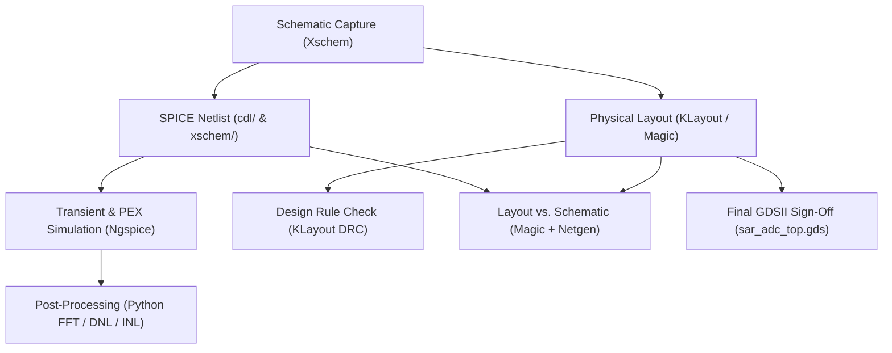

# Panduan Penggunaan EDA Tools (`iic-osic-tools`)

Target PDK: GlobalFoundries 180 nm MCU (GF180MCU Variant D, 3.3 V, 5LM)  
Container Image: `hpretl/iic-osic-tools:chipathon26`

Dokumen ini merangkum konfigurasi host Linux dan perintah kerja untuk skematik, simulasi SPICE, layout, serta verifikasi fisik pada repositori `chipathon26-SAR_ADC`.

---

## 1. Alur Perancangan dan Verifikasi



- Schematic entry: Xschem (`xschem/sar_adc/sar_adc_top.sch`)
- Simulasi sirkuit: Ngspice (`ngspice-42`)
- Layout dan DRC: KLayout dan Magic VLSI (`layout/sar_adc/sar_adc_top.gds`)
- LVS: Magic (`ext2spice lvs`) dan Netgen (`lvs/gf180mcuD_setup.tcl`)

---

## 2. Konfigurasi Host Linux

### A. Grup Docker
Agar perintah Docker dapat dijalankan tanpa `sudo`:
```bash
sudo usermod -aG docker $USER
newgrp docker
```

### B. Akses GUI (X11 Forwarding)
Untuk membuka GUI Xschem atau KLayout dari dalam container:
```bash
xhost +local:
export DISPLAY=:0
```

---

## 3. Menjalankan Container `iic-osic-tools`

### Cara 1: Menggunakan Script Wrapper (`scripts/run_docker_iic.sh`)
```bash
cd ~/eda/designs/chipathon26-SAR_ADC
./scripts/run_docker_iic.sh
```
Untuk menjalankan perintah satu baris tanpa membuka sesi interaktif:
```bash
./scripts/run_docker_iic.sh ngspice -b xschem/sar_adc/tb_sar_adc_dynamic.spice
./scripts/run_docker_iic.sh xschem xschem/sar_adc/sar_adc_top.sch
```

### Cara 2: Menggunakan `docker exec` atau `docker run`
Jika container `iic-osic-tools_chipathon_xserver_uid_1000` sudah aktif:
```bash
docker exec -it iic-osic-tools_chipathon_xserver_uid_1000 bash
```

---

## 4. Perintah Utama

### A. Skematik dan Simulasi (Xschem + Ngspice)
- Membuka skematik top-level:
  ```bash
  xschem xschem/sar_adc/sar_adc_top.sch
  ```
- Menjalankan simulasi transien batch:
  ```bash
  ngspice -b xschem/sar_adc/tb_sar_adc_dynamic.spice
  ```

### B. Layout dan Verifikasi Fisik (KLayout + Magic + Netgen)
- Membuka layout top-level (`550 µm × 1110 µm`):
  ```bash
  klayout layout/sar_adc/sar_adc_top.gds
  ```
- Menjalankan DRC top-level:
  ```bash
  python3 /foss/pdks/gf180mcuD/libs.tech/klayout/tech/drc/run_drc.py \
    --path=layout/sar_adc/sar_adc_top.gds --variant=D --thr=8 --run_dir=reports/drc_sar_adc_top
  ```
- Menjalankan LVS top-level:
  ```bash
  ./scripts/run_netgen_lvs.sh layout/sar_adc/sar_adc_top.gds sar_adc_top cdl/sar_adc_top.spice
  ```

---

## 5. Catatan Praktis Simulasi Ngspice

- Selalu jalankan container dengan UID/GID user lokal (`--user $(id -u):$(id -g)`) agar file output tidak dimiliki oleh `root`.
- Hindari penggunaan `.save all` pada simulasi transien panjang agar ukuran file `.raw` tidak membengkak. Simpan hanya node yang dianalisis:
  ```spice
  .save v(vin) v(vref) v(start) v(done) v(dout[7]) v(dout[6]) v(dout[5]) v(dout[4]) v(dout[3]) v(dout[2]) v(dout[1]) v(dout[0])
  ```

---

## 6. Pemecahan Masalah Umum

| Gejala | Penyebab | Solusi |
| :--- | :--- | :--- |
| `Cannot open display :0` | Akses X11 di host belum dibuka | Jalankan `xhost +local:` di terminal host sebelum membuka GUI. |
| `Permission denied` saat menulis file | File dibuat oleh `root` di dalam container | Jalankan `sudo chown -R $USER:$USER .` di host dan gunakan `--user $(id -u):$(id -g)`. |
| `Out of Memory` pada Ngspice | Penggunaan `.save all` pada simulasi panjang | Ganti `.save all` dengan `.save` pada node spesifik yang dibutuhkan. |
