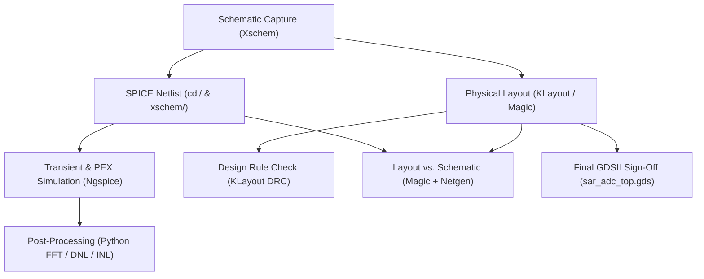

# EDA Tools Guide: IIC-OSIC-Tools

Target PDK: GlobalFoundries 180 nm MCU (GF180MCU Variant D, 3.3 V, 5LM)  
Container Image: `hpretl/iic-osic-tools:chipathon26`

This document summarizes host configuration and tool commands for schematics, SPICE simulation, layout, and physical verification in the `chipathon26-SAR_ADC` repository.

---

## 1. Design and Verification Flow



- Schematic capture: Xschem (`xschem/sar_adc/sar_adc_top.sch`)
- Circuit simulation: Ngspice (`ngspice-42`)
- Layout and DRC: KLayout and Magic VLSI (`layout/sar_adc/sar_adc_top.gds`)
- LVS: Magic (`ext2spice lvs`) and Netgen (`lvs/gf180mcuD_setup.tcl`)

---

## 2. Linux Host Configuration

### A. Docker Group Membership
To run Docker without `sudo`:
```bash
sudo usermod -aG docker $USER
newgrp docker
```

### B. GUI Access (X11 Forwarding)
To enable GUI windows for Xschem or KLayout from the container:
```bash
xhost +local:
export DISPLAY=:0
```

---

## 3. Running the `iic-osic-tools` Container

### Method 1: Using the Wrapper Script (`scripts/run_docker_iic.sh`)
```bash
cd ~/eda/designs/chipathon26-SAR_ADC
./scripts/run_docker_iic.sh
```
To run batch commands non-interactively:
```bash
./scripts/run_docker_iic.sh ngspice -b xschem/sar_adc/tb_sar_adc_dynamic.spice
./scripts/run_docker_iic.sh xschem xschem/sar_adc/sar_adc_top.sch
```

### Method 2: Using `docker exec`
If the container `iic-osic-tools_chipathon_xserver_uid_1000` is already running:
```bash
docker exec -it iic-osic-tools_chipathon_xserver_uid_1000 bash
```

---

## 4. Primary Tool Commands

### A. Schematics and Simulation (Xschem + Ngspice)
- Open top-level schematic:
  ```bash
  xschem xschem/sar_adc/sar_adc_top.sch
  ```
- Run batch transient simulation:
  ```bash
  ngspice -b xschem/sar_adc/tb_sar_adc_dynamic.spice
  ```

### B. Layout and Physical Verification (KLayout + Magic + Netgen)
- Open top-level layout (`605 µm × 1110 µm`):
  ```bash
  klayout layout/sar_adc/sar_adc_top.gds
  ```
- Run top-level DRC:
  ```bash
  python3 /foss/pdks/gf180mcuD/libs.tech/klayout/tech/drc/run_drc.py \
    --path=layout/sar_adc/sar_adc_top.gds --variant=D --thr=8 --run_dir=reports/drc_sar_adc_top
  ```
- Run top-level LVS:
  ```bash
  ./scripts/run_netgen_lvs.sh layout/sar_adc/sar_adc_top.gds sar_adc_top cdl/sar_adc_top.spice
  ```

---

## 5. Practical Ngspice Simulation Notes

- Run the container with the local user UID/GID (`--user $(id -u):$(id -g)`) to ensure output files have local write permissions.
- Avoid using `.save all` in long transient simulations to keep `.raw` file sizes manageable. Save only analyzed nodes:
  ```spice
  .save v(vin) v(vref) v(start) v(done) v(dout[7]) v(dout[6]) v(dout[5]) v(dout[4]) v(dout[3]) v(dout[2]) v(dout[1]) v(dout[0])
  ```

---

## 6. Common Troubleshooting

| Symptom | Cause | Solution |
| :--- | :--- | :--- |
| `Cannot open display :0` | Host X11 access not granted | Run `xhost +local:` in the host terminal before opening GUI tools. |
| `Permission denied` on writing files | Files created as `root` inside the container | Run `sudo chown -R $USER:$USER .` on the host and use `--user $(id -u):$(id -g)`. |
| Out of memory during Ngspice simulation | Excessive node saving with `.save all` | Replace `.save all` with explicit `.save` directives for needed nodes. |
